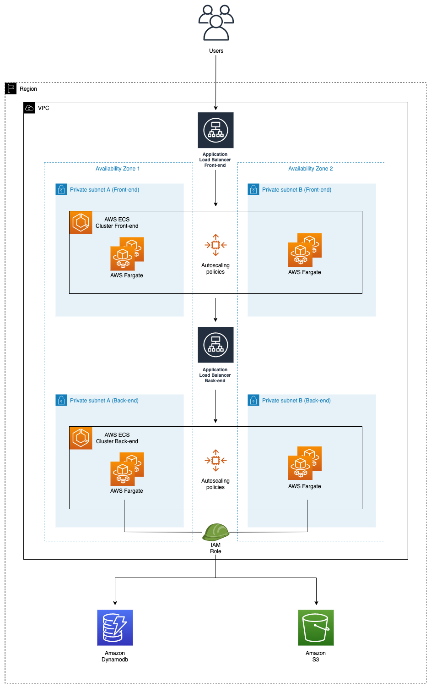
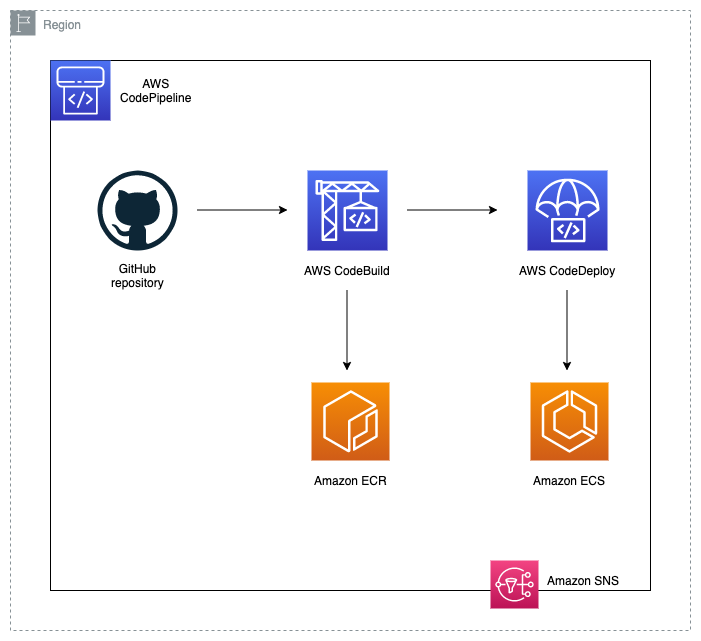

# Enterprise-grade DevOps Stack with Amazon EKS

This repository contains a complete **enterprise-grade DevOps stack** using **Amazon EKS (Kubernetes)** with full CI/CD automation, demonstrating modern containerized application deployment best practices.

## 🏗️ Architecture Overview

This project showcases a complete DevOps pipeline using:

- **Amazon EKS** - Managed Kubernetes service for container orchestration
- **Terraform** - Infrastructure as Code for reproducible deployments
- **AWS Load Balancer Controller** - Kubernetes ingress using ALB
- **Horizontal Pod Autoscaler (HPA)** - Automatic scaling based on CPU/Memory
- **ECR** - Container image storage
- **CodePipeline** - CI/CD automation with GitHub integration
- **CodeBuild** - Build and deployment to Kubernetes

## Table of Contents

   * [What Gets Deployed](#what-gets-deployed)
   * [Prerequisites](#prerequisites)
   * [Quick Start](#quick-start)
   * [Infrastructure Architecture](#infrastructure-architecture)
   * [CI/CD Architecture](#cicd-architecture)
   * [Application Code](#application-code)
   * [Post-Deployment Setup](#post-deployment-setup)
   * [Monitoring and Scaling](#monitoring-and-scaling)
   * [Alternative: ECS Deployment](#alternative-ecs-deployment)
   * [Cleanup](#cleanup)
   * [Security](#security)

## What Gets Deployed

### AWS Infrastructure:
- **EKS Cluster** with managed node groups (2-4 nodes)
- **VPC** with public/private subnets across 2 AZs
- **ECR Repositories** for Docker images (client + server)
- **CodePipeline** with GitHub integration
- **CodeBuild Projects** with kubectl deployment
- **Application Load Balancers** (via AWS Load Balancer Controller)
- **DynamoDB Table** for application data
- **S3 Buckets** for artifacts and assets
- **IAM Roles** with IRSA (IAM Roles for Service Accounts)
- **SNS Topic** for notifications

### Kubernetes Resources:
- **Deployments** for client (Vue.js) and server (Node.js) applications
- **Services** (ClusterIP) for internal communication
- **Ingress** resources for external access via ALB
- **HorizontalPodAutoscalers** for automatic scaling
- **ServiceAccounts** with IAM role bindings

### Applications:
- **Frontend**: Vue.js client application with modern UI
- **Backend**: Node.js API server with Swagger documentation
- **Database**: DynamoDB integration for data persistence

## Prerequisites

1. **AWS CLI** configured with appropriate credentials
2. **Terraform** v0.13+ installed
3. **kubectl** installed (for cluster management)
4. **GitHub Personal Access Token** with repo permissions
5. **Fork this repository** to your GitHub account

## Quick Start

### 1. Configure AWS Credentials
```bash
# Add to ~/.aws/credentials
[your-profile-name]
aws_access_key_id = YOUR_ACCESS_KEY
aws_secret_access_key = YOUR_SECRET_KEY
```

### 2. Deploy Remote State Backend (Recommended)
```bash
cd Infrastructure/state-backend/
terraform init
terraform apply -var aws_profile="your-profile" \
                -var aws_region="us-west-2" \
                -var environment_name="your-env"

# Configure backend
cd ../
cp backend.tf.example backend.tf
# Edit backend.tf with the S3 bucket and DynamoDB table names
```

### 3. Deploy EKS Infrastructure
```bash
cd Infrastructure/

terraform init
terraform plan -var aws_profile="your-profile" \
               -var aws_region="us-west-2" \
               -var environment_name="your-unique-env-name" \
               -var github_token="your-github-token" \
               -var repository_name="your-forked-repo-name" \
               -var repository_owner="your-github-username"

terraform apply [same variables as above]
```

### 4. Configure kubectl Access
```bash
# Update kubeconfig to access your EKS cluster
aws eks update-kubeconfig --region us-west-2 --name your-unique-env-name

# Verify access
kubectl get nodes
kubectl get pods --all-namespaces
```

### 5. Install AWS Load Balancer Controller
```bash
# Install via Helm (recommended)
helm repo add eks https://aws.github.io/eks-charts
helm install aws-load-balancer-controller eks/aws-load-balancer-controller \
  -n kube-system \
  --set clusterName=your-unique-env-name \
  --set serviceAccount.create=false \
  --set serviceAccount.name=aws-load-balancer-controller
```

## Infrastructure Architecture

The following diagram represents the EKS Infrastructure architecture:

<p align="center">
  
</p>

### Remote State Backend Setup

For production use, remote state storage with DynamoDB locking is included:

- **S3 Bucket**: For secure Terraform state storage with encryption and versioning
- **DynamoDB Table**: For state locking to prevent concurrent modifications
- **Backend Configuration**: Templates and examples for configuring remote state

The state backend infrastructure is located in `Infrastructure/state-backend/` and should be deployed before the main infrastructure.

## CI/CD Architecture

The following diagram represents the CI/CD architecture:

<p align="center">
  
</p>

### Pipeline Flow:
1. **Source**: GitHub webhook triggers on push to main branch
2. **Build**: Parallel CodeBuild projects for client and server
   - Build Docker images
   - Push to ECR
   - Apply Kubernetes manifests using kubectl
3. **Deploy**: Automatic deployment to EKS cluster
   - Rolling updates for zero downtime
   - Health checks via readiness/liveness probes

## Application Code

### Client App
The Vue.js frontend application uses modern UI practices and connects to the backend API. In production, it runs on port 80, but locally uses port 3000.

### Server App
The Node.js backend application provides:
- `/status`: Health check endpoint
- `/api/getAllProducts`: Main API endpoint returning DynamoDB items
- `/api/docs`: Swagger API documentation

## Post-Deployment Setup

### 1. Add Sample Data
**S3 Assets**: Upload 3 sample images to the created S3 assets bucket

**DynamoDB Items**: Add sample items with this structure:
```json
{
  "id": {"N": "1"},
  "path": {"S": "https://your-bucket.s3.region.amazonaws.com/image.jpg"},
  "title": {"S": "Sample Product"}
}
```

### 2. Access Your Applications
```bash
# Get application URLs
kubectl get ingress

# Monitor deployment
kubectl get pods
kubectl get services
```

## Monitoring and Scaling

### Automatic Scaling
- **Cluster Autoscaler**: Automatically adds/removes nodes based on demand
- **HPA**: Scales pods based on CPU/Memory utilization (70% CPU threshold)
- **Resource Management**: Proper CPU/Memory requests and limits

### Monitoring Commands
```bash
# Monitor pod status
kubectl get pods

# Check HPA status
kubectl get hpa

# View pod logs
kubectl logs -f deployment/your-env-server

# Monitor ingress status
kubectl describe ingress your-env-server-ingress
```

### Load Testing
Test your application's scaling with Artillery:

```bash
# Update stress test files with ingress URLs first
# Frontend layer:
artillery run client/src/tests/stresstests/stress_client.yml

# Backend layer:
artillery run server/src/tests/stresstests/stress_server.yml
```

## Alternative: ECS Deployment

For teams preferring AWS ECS over Kubernetes, an ECS version is available. The ECS version provides:

- ECS Fargate services instead of Kubernetes pods
- Blue/Green deployments via CodeDeploy
- Direct ALB integration without Load Balancer Controller
- ECS Auto Scaling instead of HPA

**To use ECS instead:**
1. Check out the `ecs-version` branch or use the legacy files in `Infrastructure/legacy-ecs/`
2. Follow the original ECS deployment instructions

## Cleanup

```bash
# Delete Kubernetes resources first
kubectl delete ingress --all
kubectl delete service --all
kubectl delete deployment --all

# Then destroy Terraform infrastructure
terraform destroy -var aws_profile="your-profile" \
                  -var aws_region="your-region" \
                  -var environment_name="your-env" \
                  -var github_token="your-personal-token" \
                  -var repository_name="your-github-repository" \
                  -var repository_owner="the-github-repository-owner"
```

## Security

### Enterprise Security Features:
- **RBAC**: Kubernetes Role-Based Access Control
- **IRSA**: Secure AWS service access without long-lived credentials
- **Private Subnets**: Worker nodes in private subnets only
- **Security Groups**: Fine-grained network access control
- **Encrypted Storage**: S3 and DynamoDB encryption at rest
- **Network Policies**: Pod-to-pod communication control (extensible)

## Advantages of This EKS Stack

1. **Enterprise-Ready**: Production-grade security and scaling
2. **Kubernetes Native**: Access to full Kubernetes ecosystem
3. **Cost Optimized**: Better resource utilization than serverless alternatives
4. **CI/CD Automation**: Complete GitHub-to-production pipeline
5. **Infrastructure as Code**: Reproducible, version-controlled infrastructure
6. **Multi-Environment**: Easy to replicate across dev/staging/prod
7. **Extensible**: Easy to add monitoring, service mesh, and more

## Next Steps & Extensions

- Add **Istio** service mesh for advanced traffic management
- Implement **ArgoCD** for GitOps deployment
- Add **Prometheus + Grafana** for monitoring
- Set up **Kubernetes Network Policies** for enhanced security
- Configure **Cluster Autoscaler** for cost optimization
- Add **Spot Instance** support for further cost savings
- Implement **Cert-Manager** for automatic SSL certificate management

## License
This library is licensed under the MIT-0 License. See the [LICENSE](LICENSE) file.